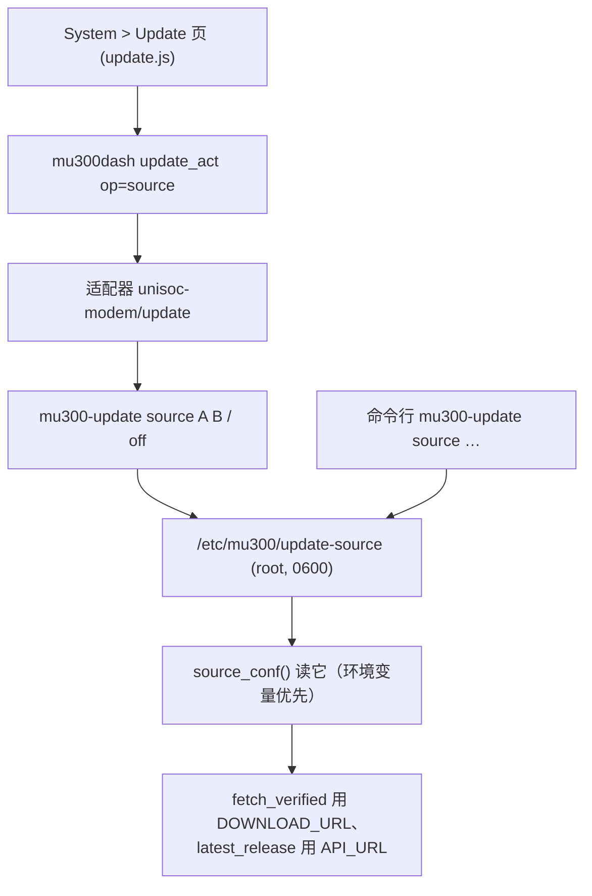

# 发布源（镜像）设置：子命令 + 面板字段 - Plan

## Goal Capsule

- **Objective:** 受限网络下的用户不用再手写一个 root 专属配置文件：命令行一条命令、面板的 System > Update 页两个字段，都能设置、查看、清除"从哪取发布"，并且页面上直接看得到当前生效的是哪个地址。
- **Means:** `mu300-update source <API_URL> <DOWNLOAD_URL>` 子命令做唯一写入者，面板经适配器调用它（KTD1–KTD4）。
- **Authority hierarchy:** 本计划 > 本次会话确认的范围（面板字段 + 保留子命令）> 仓库里既有的 `source_conf()` 与适配器的安全约定 > 代码证据。
- **Stop conditions:** 任何改动放松 `source_conf()` 的既有校验（键名白名单、URL 形状、属主/权限/非符号链接），或让适配器开始接受用环境变量传源 → 停下回报（后者是 #221 安全审查定下的）。
- **Execution profile:** shell（`mu300-update`、`unisoc-modem/update`、`mu300dash`）+ LuCI 页面 JS + 31 份 `po` 目录；测试在 `tests/`（`test_update_page.py` 已有一组 `update-source` 用例）。
- **Who finishes and ships:** 实现者改完跑测试；用户在真机上填一次并在受限网络里验证一次 `apply`。

---

## Product Contract

### Summary

给已经存在的 `/etc/mu300/update-source` 加一层人能用的入口：`mu300-update source` 子命令，以及 LuCI 更新页上的两个字段（经适配器调用同一条子命令）。写入规则完全复用 `source_conf()` 的既有校验，不引入第二套。

### Problem Frame

#221 已经把镜像机制本身做完了（`/etc/mu300/update-source`、`MU300_API_URL`/`MU300_DOWNLOAD_URL`、`SHA256SUMS` 的签名校验、面板的 Update 页）。但它只对手写文件的人可用：`docs/update-device-test.md:147` 的用法是 `printf 'MU300_API_URL=…\nMU300_DOWNLOAD_URL=…\n' > /etc/mu300/update-source; chmod 600 …`，面板页面上没有任何地方能填它，也没有任何地方告诉用户"现在从哪取"。于是用户最初的问题（受限网络下每次都要声明 `MU300_RELEASE_URL`）变成了"每次都要手写一个 root 专属文件"。

### Requirements

**命令行**

- R1. `mu300-update source <API_URL> <DOWNLOAD_URL>` 写入 `/etc/mu300/update-source`（两行 `NAME=URL`）；`mu300-update source` 打印当前生效的源（值 + 来源：环境变量还是那个文件）；`mu300-update source off` 删除该文件。
- R2. 拒绝任何 `source_conf()` 不接受的东西：只有 `MU300_API_URL`/`MU300_DOWNLOAD_URL` 两个名字、值必须匹配 `https?://[A-Za-z0-9._:/-]{1,200}`、文件必须 root 属主且组/他人不可写、不能是符号链接。写入沿用既有的原子形状（`.tmp` + `mv`），权限 0600。

**面板**

- R3. LuCI 的 System > Update 页能填这两个地址、能清除、能显示当前生效的源（含它来自文件、环境变量还是默认）。
- R4. 页面不通过环境变量传地址：它经 `mu300dash` 的新 op 调用 `mu300-update source …`，新参数进 `mu300dash` 的签名表，op 进 ACL 的 `write` 列表；改设备状态的操作沿用既有的 CONFIRM 词语义。
- R5. 两个地址不进 `mu300dash` 的调用日志（那里可能带 token）；`ops_log` 摘要里这个 op 只记操作名。

**模板与文档**

- R6. `etc/mu300/update-source.example` 随两类镜像发布（`rootfs/overlay` 与 `openwrt/overlay` 各一份），写清两个名字的含义、受限网络下的实用组合，以及"发布有签名，但地址本身仍是你选择的信任"。`wiki/Updating.md`、`README.md`、`wiki/Troubleshooting.md` 与站点对应页面补用法。
- R7. 文档写清一个实测事实：文件前缀（如 `https://ghfast.top/`）只代理 release 文件，**不代理 `api.github.com`**（403），所以两个地址通常分开填——文件走代理、API 直连 GitHub 或另找一个能代理 API 的地址。

### Key Decisions

- KD1. 地址的唯一事实来源仍是 `/etc/mu300/update-source`；`mu300-update source` 是唯一写入者，面板经适配器调用它（session-settled: user-directed — chosen over 只做面板字段或只做子命令: 用户要求两者都要）。Governs R1, R3, R4.
- KD2. 校验只复用 `source_conf()` 已有的规则，不新增第二套（session-settled: user-approved — chosen over 在面板侧另写一套校验: 同一份规则只维护一处）。Governs R2, R4.

### Success Criteria

- 一条命令设好之后，`mu300-update check`/`apply` 与面板发起的检查都从那个地址取，面板显示的就是它。
- 环境变量的优先级不变：环境变量给出时文件被忽略，页面显示的来源是环境变量。
- 真机上在受限网络里设一次、跑一次 `apply` 成功；不设时行为与改动前逐字相同。

### Scope Boundaries

**Deferred to follow-up:** Cockpit（Ubuntu）页面的 Updates 卡片加同样的字段——它的卡片只有 check/apply/version 的输出，没有发布列表；同一件事在那台机器上可以用 Terminal 或 `mu300-update source` 做。

**考虑过、这次明确不建：**

- 让适配器接受用环境变量传源：不做，且列为本计划的停止条件（R4）。`unisoc-modem/update:47-49` 已经把这些变量 unset 掉，注释写明理由："能让更新检查失效的东西只在通过校验的请求里按名字说，绝不由它碰巧运行的环境决定，也绝不来自 key 或 source"。
- `install.sh`/`install.ps1`（主机侧，各有自己的整段基址覆盖）与 web 安装器（`tools/android-web.sh` 的主机白名单只放行 GitHub 与 `*.githubusercontent.com`，将来给那一面加源时必须同时放宽）。
- `MU300_RELEASE_URL` 的兼容层：它已被 `MU300_DOWNLOAD_URL` 取代（`mu300-update:88`），本次不动。

### Sources

- `rootfs/overlay/opt/mu300/bin/mu300-update:2991-3005`（`source_conf()`：键名、URL 形状、属主/权限/非符号链接的判据；环境变量优先）；`:88`（`MU300_RELEASE_URL` → `MU300_DOWNLOAD_URL` → 默认 GitHub 的顺序）；`:234`（`MU300_API_URL` 用于 `releases/latest`）。
- 签名锚定（本次直接用，不重做）：`mu300-update:3008-3070` 的 `sums_trusted`/`sums_verdict`/`sig_state`，公钥 `/opt/mu300/lib/release.pub`，逃生门 `--unsigned`/`MU300_ALLOW_UNSIGNED`。
- 适配器与后端：`openwrt/luci-app-mu300/root/usr/libexec/unisoc-modem/update`（`:2-4` 的原则、`:47-49` 的 unset 列表、`update act` 的 op 与 CONFIRM、`run_cmd`）、`root/usr/libexec/rpcd/mu300dash`（`:855-868` 的 `m_update_get/job/act`、`:936-938` 的签名表、`:1014` 的日志摘要、`:1092-1095` 的免日志分支）、`root/usr/share/rpcd/acl.d/luci-app-mu300.json`。
- 页面：`openwrt/luci-app-mu300/htdocs/luci-static/resources/view/mu300/update.js`。
- 既有测试与文档：`tests/test_update_page.py:1078-1108`（`update-source` 读取规则的一组用例）、`tests/test_luci_i18n.py`、`docs/update-device-test.md:147`（今天的手写用法）。

---

## Planning Contract

### Key Technical Decisions

- KTD1. 子命令形状：`mu300-update source [<API_URL> <DOWNLOAD_URL>|off]`。写入复用 `rootfs/overlay/opt/mu300/bin/mu300-cpu:37-50` 的 `conf_set` 原子形状；写前按 `source_conf()` 的同一条正则与同样的属主/权限判据自校验，写后读回确认生效；`mu300-update` 的头部注释、`-h` 的 `sed` 范围、末尾 `*)` 用法串三处一起改。
- KTD2. 面板经适配器调子命令，而不是自己写文件：`update_act` 增加 `source` op，`mu300dash` 的签名表增加两个地址参数（沿用现有的 `String` 槽位），`m_update_act` 把它们按位置传给适配器，适配器再变成 `mu300-update source A B` / `source off`；op 沿用 CONFIRM 词与 `lock_free`（改的是更新来源）。
- KTD3. 回报与显示：`update_get` 增加当前源（值 + 来源），页面用它渲染；两个地址只显示用户自己填的值，并且只进"谁在什么时候改了它"这一行摘要（`mu300dash:1014` 那条 `update_act) inp '@.op'` 的形状），不进更细的日志。
- KTD4. 模板与发布审计：两份 `.example`（`rootfs/overlay/etc/mu300/`、`openwrt/overlay/etc/mu300/`），并在 `tools/make-release.sh:117` 的发布审计里加入 `update-source`——真实配置文件绝不能被发布出去；`.example` 不在禁止名单里（对照 `:119` 那条只禁 `vpn.conf.example` 的写法）。

### High-Level Technical Design

### Sequencing

U1（子命令）先落；U2（后端 op + ACL + 回报）依赖它；U3（页面）依赖 U2；U4（模板与文档）与 U5（审计与静态接线）随实现一起改。

### Risks & Dependencies

- 依赖：适配器的安全模型不变——地址只从 root 的文件来，从不从环境来（R4 与 Stop conditions）。放松它就是安全回退。
- 风险：页面上会显示用户自己填的地址，可能带 token。缓解：只显示他自己填的值，且不进 ops 日志（R5）。
- 风险：两个地址各指一处对用户不直观。缓解：`.example` 与 wiki 给出受限网络下的实用组合，页面留一句说明（R7）。
- 依赖：`update.js` 的新字符串要同步进 31 份 `po` 目录（`tests/test_luci_i18n.py` 对缺失与空 `msgstr` 会报错）。

---

## Implementation Units

### U1. `mu300-update source` 子命令

- **Goal:** 设置、查看、清除发布源，并把用法写进帮助与 `.example`。
- **Requirements:** R1, R2
- **Dependencies:** 无
- **Files:** `rootfs/overlay/opt/mu300/bin/mu300-update`, `rootfs/overlay/etc/mu300/update-source.example`, `openwrt/overlay/etc/mu300/update-source.example`, `tests/test_update_page.py`
- **Approach:**
  1. 三条命令形态：两个参数 → 写文件（`mkdir -p "$CONF"`、`.tmp` + `mv`、`chmod 600`）；无参数 → 打印生效值与来源；`off` → 删文件并打印"not in use"。
  2. 校验用 `source_conf()` 的同一条正则与同样的属主/权限判据；不合法就拒绝并说明（不改文件）。
  3. 头部注释、`-h` 的 `sed` 范围、`*)` 用法串一起改（该范围在本文件只有一处）。
  4. 两份 `.example` 写清两个名字、受限网络组合、签名的含义。
- **Patterns to follow:** `rootfs/overlay/opt/mu300/bin/mu300-cpu:37-50`（写配置）、`rootfs/overlay/opt/mu300/bin/mu300-update:2993-3005`（校验与读取）、`rootfs/overlay/etc/mu300/mobile-data.conf.example`（`.example` 语气）。
- **Test scenarios:**
  - 设好两个地址后，`source_conf` 生效且 `fetch_verified v1 x` / `latest_release` 用的是它们（stub `fetch_file`/`fetch_stdout` 记录 URL）。
  - 不合法的值：`file:///etc`、含 `$(reboot)`、超长、空串——都被拒绝，文件内容不变。
  - `source` 无参数：分别在有环境变量、只有文件、都没有的三种情况下打印值与来源。
  - `source off`：文件被删，随后 `fetch_verified` 回到默认 base（固定字符串断言）。
  - 权限与属主：写出的文件是 0600 且属主是当前用户；指向同一路径的符号链接被 `source_conf` 忽略（沿用 `tests/test_update_page.py:1078-1108` 既有的那组用例）。
- **Verification:** 上面每条都有用例；未设置时生成的 URL 与改动前逐字相同。

### U2. 后端的 op、权限与回报

- **Goal:** 面板能设置/清除/读取源，且不放松任何既有校验。
- **Requirements:** R4, R5
- **Dependencies:** U1
- **Files:** `openwrt/luci-app-mu300/root/usr/libexec/unisoc-modem/update`, `openwrt/luci-app-mu300/root/usr/libexec/rpcd/mu300dash`, `openwrt/luci-app-mu300/root/usr/share/rpcd/acl.d/luci-app-mu300.json`, `tests/test_update_page.py`
- **Approach:**
  1. `update_act` 增加 `source` op：接受两个地址或 `off`，沿用 CONFIRM 词与 `lock_free`；把它变成一条 `mu300-update source …`（`run_cmd`，不设任何 `MU300_*` 环境变量）。
  2. `mu300dash`：签名表加两个 `String` 参数，`m_update_act` 按位置传下去；日志摘要只记 op 名。
  3. `update_get` 增加当前源（值 + `file|env|github` 的来源标记）。
  4. ACL 的 `write` 列表加 `update_act`（已有）——确认 op 走的是同一个方法，不需要新 ACL 项；若新增独立方法则同时加 ACL。
- **Patterns to follow:** 同文件里 `ttl_set`/`cpu_set` 这类写 op 的形状；`unisoc-modem/update` 里 `apply`/`clean` 的 CONFIRM 与 `run_cmd` 用法。
- **Test scenarios:**
  - 设/清各一次，断言 `/etc/mu300/update-source` 的内容与权限。
  - CONFIRM 词不对时不写文件。
  - 非法参数（形状不对）被后端或适配器拒绝，文件不变。
  - `update_get` 的源字段：文件、环境变量、默认三种情况各一条。
  - ops 日志里出现这次改动，但**不含**两个地址。
- **Verification:** 后端测试通过；页面用到的 op 名与 ACL/签名表一致（静态断言）。

### U3. System > Update 页的来源区

- **Goal:** 在既有页面上填、清、看发布源。
- **Requirements:** R3
- **Dependencies:** U2
- **Files:** `openwrt/luci-app-mu300/htdocs/luci-static/resources/view/mu300/update.js`, `openwrt/luci-app-mu300/po/*/mu300.po`, `tests/test_update_page.py`, `tests/test_luci_i18n.py`
- **Approach:**
  1. 加一块"来源"：两个输入框、保存、清除、当前生效值（含来源），沿用页面既有的 `E()` 渲染、确认弹窗与错误显示方式（页面注释里的规则：值一律走 `E()` 的数组形式当文本显示）。
  2. 空输入等于清除；非法地址的错误由后端说，页面原样显示。
  3. 新字符串进 31 份 `po`（tr 与 zh_Hans 必须有译文，其余目录至少不缺失）。
- **Patterns to follow:** 同页面里既有的确认弹窗与 busy/错误处理；`vpn-settings.js` 的输入校验写法。
- **Test scenarios:**
  - 页面渲染与 `update_get` 的源字段接线（`tests/test_update_page.py` 的页面断言）。
  - i18n：新字符串在 `tr`/`zh_Hans` 目录里都有非空译文，`tools/po2lmo` 能编译。
  - 空输入触发清除路径，非法输入不改文件。
- **Verification:** `test_luci_i18n.py` 干净；页面在三语下都能呈现所填的值。

### U4. 模板与文档

- **Goal:** 用户从 README 或 wiki 能照做，`.example` 讲清两个地址。
- **Requirements:** R6, R7
- **Dependencies:** U1
- **Files:** `rootfs/overlay/etc/mu300/update-source.example`, `openwrt/overlay/etc/mu300/update-source.example`, `wiki/Updating.md`, `wiki/Troubleshooting.md`, `README.md`, `site/install/index.html`, `site/troubleshooting/index.html`, `site/updates/index.html`（含 `zh/` 与 `tr/`）
- **Approach:**
  1. `.example`：两个名字各自的含义（API 用于"最新是哪个版本"，DOWNLOAD 用于"文件从哪下"）、受限网络的组合示例、签名意味着什么（"字节与签名对得上就是项目的发布"）。
  2. `wiki/Updating.md` 加一小节：面板怎么填、命令行怎么填、`source off` 怎么回退。
  3. "下载慢"那几处在 `MU300_FETCH_JOBS` 之外补上持久化地址的写法；`site/*/updates/` 那几页（手取 updater 的命令）加一句指向新的设置方式。
- **Test expectation:** none -- 纯文档；由 U5 的静态断言覆盖 `.example` 的存在与内容。
- **Verification:** 三种语言的页面与 wiki 讲的是同一件事，命令示例逐字可复制。

### U5. 发布审计与静态接线

- **Goal:** 发布流程不会把配置过的 `update-source` 发出去，新接线有断言。
- **Requirements:** R6
- **Dependencies:** U1
- **Files:** `tools/make-release.sh`, `tests/test_static.py`
- **Approach:** 审计正则（`tools/make-release.sh:117` 的 `^etc/mu300/(hotspot|vpn|toolkit|mobile-data)\.conf$` 一族）加入 `update-source`（真实文件必须禁止；`.example` 不加入禁止名单）；静态断言两份 `.example` 存在且含两个键名、`mu300dash` 的 op 与 ACL 一致。
- **Patterns to follow:** 同文件里对 `vpn.conf` 与 `.example` 的既有断言（`tests/test_static.py:265-272`）。
- **Test scenarios:**
  - 含 `./etc/mu300/update-source` 的假 tarball 被审计拒收。
  - 两份 `.example` 存在、含 `MU300_API_URL` 与 `MU300_DOWNLOAD_URL`。
  - `update_act` 的 op 列表与页面调用的名字一致。
- **Verification:** `tests/test_static.py` 全绿。

---

## Verification Contract

| 命令 | 证明什么 | 何时 |
|---|---|---|
| `python3 -m unittest discover -s tests -p 'test_update_page.py'` | 子命令、后端 op、页面接线 | U1–U3 |
| `python3 -m unittest discover -s tests -p 'test_luci_i18n.py'` | 新字符串在 31 份目录里 | U3 |
| `python3 -m unittest discover -s tests -p 'test_static.py'` | 发布审计、两份 `.example`、op 与 ACL 一致 | U5 |
| `MU300_TEST_SHELLS="busybox sh" python3 -m unittest discover -s tests` | dash/bash/busybox ash 下都过 | 收尾 |
| 真机：面板 System > Update 填两个地址 → `mu300-update source` 显示同一个 → `apply` 成功 | 端到端（受限网络） | 收尾 |
| 真机：`mu300-update source off` → `check` | 清除后回到默认 | 收尾 |

## Definition of Done

- 每条 R 都能在测试或真机上看到；`tests/` 全套在 dash、bash、busybox ash 下通过。
- 不设置时行为与改动前逐字相同（默认 base 的固定字符串断言）。
- 面板显示的源与 `mu300-update source` 显示的一致；两个地址不出现在 ops 日志里。
- 文档与两份 `.example` 一致，受限网络下"两个地址各填什么"能照着做。
- **Cleanup:** 不留实验代码或临时脚本；地址校验只有 `source_conf()` 一处、写入只有子命令一处；分析用的临时文件不在仓库里。
