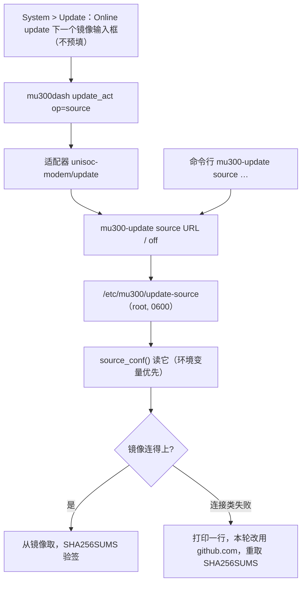

# 面板的镜像源前缀（Online update 下一个字段 + 对应子命令）- Plan

## Goal Capsule

- **Objective:** 受限网络里的用户在 LuCI 的 System > Update 页 "Online update" 下面填一个镜像地址就能一直用它取发布文件；镜像连不上时设备打印一行并回退官方 GitHub，不会因此装不上；命令行有同一条对应的子命令。
- **Means:** 复用已经存在的 `/etc/mu300/update-source`（#221 带来的），只给它加一个命令行写入者、一个面板字段与一次回退（KTD1–KTD5）。
- **Authority hierarchy:** 本计划 > 本次会话确认的范围（一个字段、不预填、连不上回退、补子命令）> 仓库既有的 `source_conf()` 与适配器约定 > 代码证据。
- **Stop conditions:** 任何改动放松 `source_conf()` 的既有校验（键名、URL 形状、属主/权限/非符号链接），或让适配器开始接受用环境变量传源 → 停下回报。
- **Execution profile:** shell（`mu300-update`、`unisoc-modem/update`、`mu300dash`）+ 一个 LuCI 页面字段 + `po` 目录；测试在 `tests/`。
- **Who finishes and ships:** 实现者改完跑测试；用户在真机受限网络里填一次、跑一次 `apply`（含一次不可达地址的回退）。

---

## Product Contract

### Summary

`/etc/mu300/update-source` 已经能换发布源，但只有手写文件的人用得上。这次补三件事：一条 `mu300-update source` 子命令、页面 "Online update" 下面的一个镜像字段、镜像连不上时回退官方 GitHub 并说明。

### Problem Frame

#221 把镜像机制做完了（文件、签名校验、面板 Update 页），用法却是 `printf '…' > /etc/mu300/update-source; chmod 600 …`（`docs/update-device-test.md:147`）：界面上没有地方填，也不显示现在从哪取。用户最初的诉求就是"在面板里填一次、以后不用管"，加上一个兜底：第三方代理会短暂失效，那时不能连更新都做不了。

### Requirements

**命令行**

- R1. `mu300-update source <URL>` 把发布文件镜像写进 `/etc/mu300/update-source` 的 `MU300_DOWNLOAD_URL` 行，同一文件里别的行原样保留；`mu300-update source` 打印当前生效值及其来源（环境变量、那个文件、还是默认）；`mu300-update source off` 删掉这一行（文件因此空了就删掉文件）。
- R2. 写入沿用 `source_conf()` 的既有判据：值必须匹配 `https?://[A-Za-z0-9._:/-]{1,200}`，文件 root 属主、组/他人不可写、非符号链接；写前自校验，写后权限 0600。

**面板**

- R3. LuCI 的 System > Update 页在既有的 "Online update"（Check for updates / Not checked yet）那段下面加一个输入框（"发布文件镜像"）：**不预填**，当前生效的值以文本显示在旁边；保存时为空即清除。面板只能报"文件里的值"或"默认的 GitHub"（环境变量到不了面板）。
- R4. 页面经 `mu300dash` 的新 op 调 `mu300-update source <URL>` / `source off`，不通过环境变量传地址；op 用它自己的确认词与既有的 `lock_free`。

**行为**

- R5. 镜像生效期间，所有发布文件下载都从它取（#221 已有）。
- R6. 镜像**连不上**（连接被拒、DNS 失败、超时、连接被重置）时：打印一行说明，这次运行余下的下载改用官方 GitHub（两侧都用默认），并让它从那里重取按 tag 缓存的 `SHA256SUMS`；镜像**连得上但内容不对**（HTTP 404、哈希不符、签名不符）不回退——按现状停下报错。回退不写文件，下次运行仍按用户设置走镜像。
- R7. 不设置时，生成的 URL 与行为与改动前逐字相同。

**文档**

- R8. `etc/mu300/update-source.example` 随两类镜像发布（`rootfs/overlay` 与 `openwrt/overlay` 各一份），写清两个名字的含义与"发布有签名、但地址仍是你选择的信任（无发布密钥的设备上，镜像与运行更新的人同等可信）"；`wiki/Updating.md` 加一小节（面板怎么填、`source` 怎么用、`off` 怎么退），并把"下载慢"那句里的 `MU300_RELEASE_URL` 换成这个持久化写法，附实测一句：文件前缀（如 `https://ghfast.top/`）只代理 release 文件、不代理 `api.github.com`（403），所以两个名字通常分开填。

### Key Decisions

- KD1. 地址的唯一事实来源仍是 `/etc/mu300/update-source`；`mu300-update source` 是面板与命令行两侧共同的写入者（面板经适配器调它），不新增第二套读写（session-settled: user-directed — chosen over 面板直接写文件: 仓库的原则是"适配器不是第二个 updater"）。Governs R1, R4.
- KD2. 校验只复用 `source_conf()` 已有的规则，不新增第二套（session-settled: user-approved — chosen over 在面板侧另写一套校验: 同一份规则只维护一处）。Governs R2, R4.
- KD3. 面板只给一个字段（下载侧），不预填；API 侧地址留在文件与命令行里（session-settled: user-directed — chosen over 页面给两个地址字段: 用户只要一个镜像前缀）。Governs R3.

### Success Criteria

- 在面板里填一个镜像地址之后，`mu300-update check`/`apply` 与面板发起的检查都从它取，页面显示的值与命令行显示的一致。
- 填一个不可达的地址：`apply` 打印一行回退说明并改用官方 GitHub 完成更新。
- 不设置时行为与改动前逐字相同。

### Scope Boundaries

**Deferred to follow-up:** Cockpit（Ubuntu）页面的 Updates 卡加同样字段；`README.md`、`wiki/Installation.md`、`wiki/Troubleshooting.md` 与 site 三组页面的文案同步（wiki/Updating.md 这一节已覆盖同一件事）；API 侧地址的页面/子命令入口（需要时手改文件，`.example` 里写了）。

**考虑过、这次明确不建：**

- 让适配器接受用环境变量传源：不做，且列为停止条件。`unisoc-modem/update:36-39` 已经把这些变量 unset 掉，注释写明理由："能让更新检查失效的东西只在通过校验的请求里按名字说，绝不由它碰巧运行的环境决定，也绝不来自 key 或 source"。
- 把地址从后端每次启动的取证副本（`mu300dash` 的 `run_m` 把每个方法的回复原样追加到 `$LASTLOG`）里排除：不建。那份文件与 ops 日志都只对 root/管理员可读，值又是用户自己填的，为一个方法在日志路径上开例外不值当；只在 ops 摘要里留"只记操作名"。
- `MU300_RELEASE_URL` 的兼容层：它已被 `MU300_DOWNLOAD_URL` 取代（`mu300-update:88`），本次不动。
- `install.sh`/`install.ps1` 与 web 安装器（`tools/android-web.sh` 的主机白名单只放行 GitHub 与 `*.githubusercontent.com`）。

### Sources

- `rootfs/overlay/opt/mu300/bin/mu300-update:2994`（`source_conf()`：两个键名、URL 形状、属主/权限/非符号链接；环境变量优先）、`:88`（`MU300_RELEASE_URL` → `MU300_DOWNLOAD_URL` → 默认 GitHub）、`:233`（`latest_release`）、`:83`（`fetch_verified`）、`:59-72`（`fetch_stdout`，把 curl 的 6/7/35/52/56 当作可重试）、`:73-76`（`fetch_file`）、`:3008-3130`（`sums_trusted`/`sums_verdict`/`sig_state`/`key_state`，公钥 `/opt/mu300/lib/release.pub`）。
- 面板与后端：`openwrt/luci-app-mu300/root/usr/libexec/unisoc-modem/update`（`:2-4` 的原则、`:36-39` 的 unset 列表、`update act` 的 op 与 CONFIRM、`run_cmd`）、`root/usr/libexec/rpcd/mu300dash`（`:855-868` `m_update_get/job/act`、`:936-938` 签名表、`:1014` 日志摘要、`:1065-1075` `run_m`）、`root/usr/share/rpcd/acl.d/luci-app-mu300.json`（`update_act` 已在 write 列表，不需要新项）、`htdocs/luci-static/resources/view/mu300/update.js:263-271`（`Online update` 卡片与状态行）。
- 既有测试与文档：`tests/test_update_page.py:1078-1108`（`update-source` 读取规则的用例）、`tests/test_luci_i18n.py`、`docs/update-device-test.md:147`（今天的手写用法）。

---

## Planning Contract

### Key Technical Decisions

- KTD1. 子命令形状：`mu300-update source [<URL>|off]`。写 `MU300_DOWNLOAD_URL` 那一行，别的行原样保留；`off` 只删这一行，文件空了才删文件。写入是 `mkdir -p "$CONF"` + `.tmp` + `mv` + `chmod 600`（`rootfs/overlay/opt/mu300/bin/mu300-cpu:37-50` 的形状），写前按 `source_conf()` 的同一条正则与同样的属主/权限判据自校验；头部注释、`-h` 的 `sed` 范围、末尾 `*)` 用法串三处一起改。
- KTD2. 面板经适配器调子命令：`update_act` 增加 `source` op，`mu300dash` 的签名表加一个 `String` 参数，`m_update_act` 按位置传下去，适配器执行 `mu300-update source <URL>` / `source off`；op 用自己的确认词（现有白名单是 `(apply|rollback|clean|kernel)`，加 `source`）与 `lock_free`。确认词不改会让每次调用被静默拒绝。
- KTD3. 显示：`update_get` 增加当前值与来源（`file|github`），页面用它渲染旁边那行文本；ops 摘要里这个 op 只记操作名（`mu300dash:1014` 那条 `update_act) inp '@.op'` 的形状）。
- KTD4. 回退（R6）落在网络的两个门口：`fetch_stdout`（`:59-72`，已经区分这组连接错误码）与 `fetch_file`（`:73-76`，今天不看返回码）。镜像生效时拿到 6/7/28/35/52/56 就打印一行、把本轮 base 换成默认 GitHub、作废按 tag 缓存的 `SHA256SUMS`（让它从新 base 重取）；HTTP 22、哈希不符、签名不符不触发；每个运行只切一次、不写文件。
- KTD5. 模板与发布审计：两份 `.example`（`rootfs/overlay/etc/mu300/`、`openwrt/overlay/etc/mu300/`）与 `tools/make-release.sh:167` 的审计名单加 `update-source`（真实文件绝不能被发布；`.example` 不加，对照 `:169`）。

### High-Level Technical Design

### Sequencing

U1（子命令）先落；U2（后端 op + 回报）依赖它；U3（页面）依赖 U2；U6（回退）依赖 U1，可与 U3 并行；U4（模板与 docs）与 U5（审计与静态接线）随实现一起改。

### Risks & Dependencies

- 依赖：回退要用到官方 GitHub——两条路都不通时更新本来就做不到，回退只是把"镜像坏了"这一种失败与"两个都坏了"区分开。
- 已知：面板字段上线后，持有 `luci-app-mu300` ACL 的管理员也能改这个文件（在此之前只有 root 能）。这与 `docs/FINDINGS.md:5547` 那句"能写它的只有 root"不再完全相符；按仓库惯例由实现者追加一节说明，而不是改旧文。
- 风险：受限网络里两个地址常分处两地（文件走代理、API 直连），`.example`/wiki 要把这件事写清（R8）。

---

## Implementation Units

### U1. `mu300-update source` 子命令

- **Goal:** 设置、查看、清除发布文件镜像，并把用法写进帮助。
- **Requirements:** R1, R2, R7
- **Dependencies:** 无
- **Files:** `rootfs/overlay/opt/mu300/bin/mu300-update`, `rootfs/overlay/etc/mu300/update-source.example`, `openwrt/overlay/etc/mu300/update-source.example`, `tests/test_update_page.py`
- **Approach:**
  1. 三个形态按 KTD1：写一行、打印、删一行；`mkdir -p` + `.tmp` + `mv` + `chmod 600`，别的行保留。
  2. 校验沿用 `source_conf()` 的同一条正则与同样的属主/权限判据，不合法就拒绝并说明（不改文件）。
  3. 头部注释、`-h` 的 `sed` 范围、`*)` 用法串一起改。
  4. 两份 `.example` 写清两个名字、受限网络组合、签名意味着什么。
- **Patterns to follow:** `rootfs/overlay/opt/mu300/bin/mu300-cpu:37-50`（写配置）、`rootfs/overlay/opt/mu300/bin/mu300-update:2994`（读取与校验）、`rootfs/overlay/etc/mu300/mobile-data.conf.example`（`.example` 语气）。
- **Test scenarios:**
  - `source https://ghfast.top/` 之后文件里有 `MU300_DOWNLOAD_URL=https://ghfast.top/`，而文件里原有的其它行逐字保留；`fetch_verified v1 x` 生成的 URL 带这个前缀（stub 记录 URL）。
  - 不合法的值（`file:///etc`、含 `$(reboot)`、超长、空）被拒绝，文件不变。
  - `source` 无参数：环境变量在场、只有文件、都没有，三种情况各打印一次正确的值与来源。
  - `source off`：那一行被删、别的行还在；文件因此为空时文件被删；随后 `fetch_verified` 回到默认 base（固定字符串断言）。
  - 权限与属主：写出的文件 0600、属主是当前用户；指向同一路径的符号链接被忽略（沿用 `tests/test_update_page.py:1078-1108` 既有用例）。
- **Verification:** 每条都有用例；未设置时生成的 URL 与改动前逐字相同。

### U2. 后端的 op 与回报

- **Goal:** 面板能设置/清除并读回当前镜像，且不放松任何既有校验。
- **Requirements:** R4, R5
- **Dependencies:** U1
- **Files:** `openwrt/luci-app-mu300/root/usr/libexec/unisoc-modem/update`, `openwrt/luci-app-mu300/root/usr/libexec/rpcd/mu300dash`, `tests/test_update_page.py`
- **Approach:**
  1. `update_act` 增加 `source` op（一个地址或 `off`），用 KTD2 的确认词与 `lock_free`，执行一条 `mu300-update source …`（`run_cmd`，不设任何 `MU300_*`）。
  2. `mu300dash`：签名表加一个 `String`（下载侧），`m_update_act` 按位置传下去；只做形状白名单（真正的校验在子命令里）；更新那句"没有输入进到适配器"的注释；日志摘要只记 op 名。
  3. `update_get` 增加当前值 + `file|github` 来源标记。
- **Patterns to follow:** 同文件里 `ttl_set`/`cpu_set` 这类写 op；适配器里 `apply`/`clean` 的 CONFIRM 与 `run_cmd`。
- **Test scenarios:**
  - 设/清各一次，断言文件内容与权限。
  - 确认词不对时不写文件。
  - 形状不对的参数被拒绝，文件不变。
  - `update_get` 的源字段：有文件、没有文件（默认）各一条；环境里放一个源时断言适配器忽略它、面板报文件或默认。
  - ops 摘要里出现这次改动但不含地址。
  - 静态断言：`source` 在确认词白名单里。
- **Verification:** 后端测试通过；op 名与 ACL/签名表一致。

### U3. Online update 下面的镜像字段

- **Goal:** 在既有页面上填、清、看这一个地址。
- **Requirements:** R3
- **Dependencies:** U2
- **Files:** `openwrt/luci-app-mu300/htdocs/luci-static/resources/view/mu300/update.js`, `openwrt/luci-app-mu300/po/*/mu300.po`, `tests/test_update_page.py`, `tests/test_luci_i18n.py`
- **Approach:**
  1. 在 `Online update` 卡片里、Check for updates 与状态行（`Not checked yet` / `Checked %s ago`）下面加一行：一个输入框 + 保存按钮；当前生效值以文本显示在旁边；输入框不预填。
  2. 保存为空 = 清除；非空 = `source <URL>`；错误由后端说、页面原样显示；保存成功后重读并刷新那行文本。
  3. 新字符串进 31 份 `po`（tr 与 zh_Hans 必须有译文）。
- **Patterns to follow:** 同卡片既有的渲染与 busy/错误处理（`update.js:263-271`）；`vpn-settings.js` 的输入与错误显示。
- **Test scenarios:**
  - 页面渲染与 `update_get` 的源字段接线。
  - 不预填：值出现在文本里、不在输入框里。
  - i18n：新字符串在 `tr`/`zh_Hans` 有非空译文，`tools/po2lmo` 能编译。
  - 空输入走清除路径，非法输入不改文件。
- **Verification:** `test_luci_i18n.py` 干净；三语下都能呈现。

### U4. 模板与文档

- **Goal:** 有一个地方能照着填、照着退回。
- **Requirements:** R8
- **Dependencies:** U1
- **Files:** `rootfs/overlay/etc/mu300/update-source.example`, `openwrt/overlay/etc/mu300/update-source.example`, `wiki/Updating.md`
- **Approach:** `.example` 讲清两个名字、受限网络的组合、签名在那台设备上的含义；`wiki/Updating.md` 一小节：面板怎么填、`mu300-update source`/`off` 怎么用、"下载慢"那句改成这个持久化写法，并附文件前缀不代理 API 的实测一句。
- **Test expectation:** none -- 纯文档；由 U5 的静态断言覆盖 `.example` 的存在与内容。
- **Verification:** 命令示例逐字可复制；`.example` 与实际行为一致。

### U5. 发布审计与静态接线

- **Goal:** 发布流程不会把配置过的 `update-source` 发出去，新接线有断言。
- **Requirements:** R8
- **Dependencies:** U1
- **Files:** `tools/make-release.sh`, `tests/test_static.py`
- **Approach:** 审计正则（`tools/make-release.sh:167`）加 `update-source`（真实文件禁止；`.example` 不加，对照 `:169`）；静态断言两份 `.example` 存在且含两个键名、`update_act` 的 op 与页面调用的名字一致。
- **Test scenarios:** 含 `./etc/mu300/update-source` 的假 tarball 被拒收；两份 `.example` 存在且内容正确。
- **Verification:** `tests/test_static.py` 全绿。

### U6. 镜像连不上时回退到 GitHub

- **Goal:** 镜像临时坏了也装得上，并且说明换了源。
- **Requirements:** R6
- **Dependencies:** U1
- **Files:** `rootfs/overlay/opt/mu300/bin/mu300-update`, `tests/test_update_page.py`
- **Approach:** 在 `fetch_stdout`/`fetch_file` 里按 KTD4 识别连接类失败：打印一行、本轮 base 换默认、作废按 tag 的 `SHA256SUMS` 缓存并从新 base 重取；只切一次；别的失败不触发。
- **Patterns to follow:** `fetch_stdout` 已有的错误分类；`fetch_verified`（`:83`）里 `SUMS_FETCHED` 的作废方式。
- **Test scenarios:**
  - 第一次请求连接失败（stub 让 curl 返回 7）：输出出现回退那一行，之后的 URL 指向 `github.com`。
  - 404 或哈希不符：**不**回退。
  - 回退后 `SHA256SUMS` 从 GitHub 重取（stub 记录请求序列：镜像的 `SHA256SUMS` → 失败 → GitHub 的 `SHA256SUMS` → 资产）。
  - 未设镜像时：失败就是失败，没有回退那行。
- **Verification:** 每条都有用例；真机上用一个不可达地址跑一次 `apply`。

---

## Verification Contract

| 命令 | 证明什么 | 何时 |
|---|---|---|
| `python3 -m unittest discover -s tests -p 'test_update_page.py'` | 子命令、后端 op、页面接线、回退 | U1–U3, U6 |
| `python3 -m unittest discover -s tests -p 'test_luci_i18n.py'` | 新字符串在 31 份目录里 | U3 |
| `python3 -m unittest discover -s tests -p 'test_static.py'` | 发布审计、两份 `.example`、op 与 ACL 一致 | U5 |
| `MU300_TEST_SHELLS="busybox sh" python3 -m unittest discover -s tests` | dash/bash/busybox ash 下都过 | 收尾 |
| 真机：面板填一个镜像地址 → `mu300-update source` 显示同一个 → `apply` 成功 | 端到端（受限网络） | 收尾 |
| 真机：填一个不可达的地址 → `apply` | 打印一行并回退官方 GitHub，更新仍完成 | 收尾 |

## Definition of Done

- 每条 R 都能在测试或真机上看到；`tests/` 全套在 dash、bash、busybox ash 下通过。
- 不设置时行为与改动前逐字相同（默认 base 的固定字符串断言）。
- 面板一个字段、不预填、空即清除；页面显示的源与命令行在无环境变量时一致。
- 镜像连不上会回退并打印一行；连得上但内容不对不回退。
- `.example` 与 wiki 一节讲的是同一件事，命令示例逐字可复制。
- **Cleanup:** 不留实验代码或临时脚本；地址校验只有 `source_conf()` 一处、写入只有子命令一处；分析用的临时文件不在仓库里。
